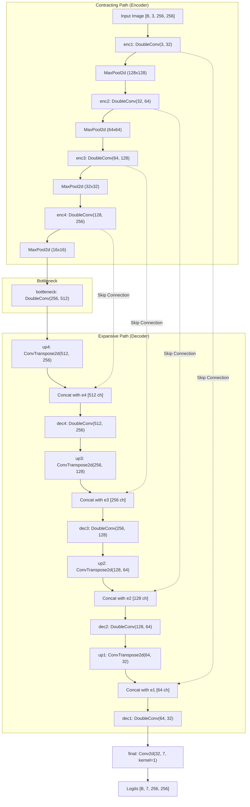

# LoveDA Geospatial Semantic Segmentation with U-Net

A PyTorch implementation of semantic segmentation for high-resolution remote-sensing imagery on the **LoveDA (Land-Cover Domain Adaptive)** dataset, classifying complex urban and rural land-cover structures into seven distinct semantic categories.

[](https://www.python.org/)
[](https://pytorch.org/)
[](https://github.com/Junjue-Wang/LoveDA)
[](#4-u-net-architecture)
[](LICENSE)

---

## 1. Overview & Motivation

High-resolution aerial and satellite imagery plays a vital role in urban planning, natural disaster assessment, environmental monitoring, and agricultural management. However, remote-sensing semantic segmentation faces significant challenges:
- **Domain Shift Across Geography:** The visual appearance of buildings, roads, and vegetation changes drastically between dense urban centers and open rural environments.
- **Complex Spatial Scales:** Objects range from massive water bodies and agricultural fields to narrow roads and compact residential dwellings.
- **Class Imbalance:** Natural classes (agriculture, water, background) often dominate pixel distributions, leaving barren land and specialized structures underrepresented.

This project trains a custom **U-Net** architecture from scratch on the LoveDA benchmark to address domain-diverse land-cover classification across both urban and rural scenes.

---

## 2. Key Features

- **7-Class Land-Cover Segmentation:** Classifies terrain into Background, Building, Road, Water, Barren, Forest, and Agriculture.
- **Dual-Domain Ingestion:** Ingests and processes both `Urban` and `Rural` geographic scenes across training and validation splits.
- **Classic U-Net Architecture:** Lightweight 7.77M parameter encoder-decoder network featuring double convolution blocks, max pooling, transposed convolutions, and feature concatenation skip connections.
- **Hybrid Region & Distribution Loss:** Combined objective function ($0.5 \times \text{CrossEntropy} + 0.5 \times \text{Dice}$) with background ignore index masking (`IGNORE_INDEX=255`).
- **Comprehensive Evaluation Pipeline:** Generates confusion matrices, class-wise IoU, class-wise Dice, precision, recall, overall pixel accuracy, and training/validation loss curves.
- **Single-Image Inference Script:** Standalone prediction module with colorized mask rendering and side-by-side comparison.

---

## 3. Dataset & Label Mapping

The project utilizes the **LoveDA (Land-Cover Domain Adaptive)** dataset:

```
LoveDA_UNet/
└── dataset/
    ├── Train/
    │   └── Train/
    │       ├── Urban/
    │       │   ├── images_png/
    │       │   └── masks_png/
    │       └── Rural/
    │           ├── images_png/
    │           └── masks_png/
    └── Val/
        └── Val/
            ├── Urban/
            │   ├── images_png/
            │   └── masks_png/
            └── Rural/
                ├── images_png/
                └── masks_png/
```

### Label Remapping & Semantics

The original LoveDA dataset includes an unused `0: No-data` class. To prepare targets for standard PyTorch loss functions, `dataset.py` subtracts 1 from all valid pixel IDs and maps `0` to `255` (`IGNORE_INDEX`):

| Original LoveDA ID | Remapped Training ID | Class Name | Description |
|:---:|:---:|:---|:---|
| `0` | `255` (Ignored) | No-data / Border | Sensor voids, unclassified borders |
| `1` | `0` | **Background** | Open terrain, ground, unpaved surfaces |
| `2` | `1` | **Building** | Commercial, industrial, and residential structures |
| `3` | `2` | **Road** | Paved highways, city streets, pathways |
| `4` | `3` | **Water** | Rivers, lakes, ponds, reservoirs |
| `5` | `4` | **Barren** | Rocks, sand, exposed soil, excavated ground |
| `6` | `5` | **Forest** | Woodlands, dense trees, orchards |
| `7` | `6` | **Agriculture** | Farmland, crop fields, cultivated vegetation |

### Preprocessing & Data Augmentation

- **Input Spatial Size:** Resized to $256 \times 256$ pixels (Bilinear interpolation for RGB imagery; Nearest Neighbor interpolation for semantic mask integer labels).
- **RGB Normalization:** Scaled using standard ImageNet channel statistics:
  - Mean: $\mu = [0.485, 0.456, 0.406]$
  - Std: $\sigma = [0.229, 0.224, 0.225]$
- **Online Augmentation (Training Split):**
  - Random Horizontal Flip ($p = 0.5$)
  - Random Vertical Flip ($p = 0.5$)
  - Random $90^\circ$ Rotation ($p = 0.5$, choosing $k \in \{1, 2, 3\}$)

---

## 4. U-Net Architecture

The network implemented in `model.py` follows a symmetric U-Net design:



### Layer & Parameter Summary

- **DoubleConv Block:** $\text{Conv2d}(3\times3, p=1) \rightarrow \text{BatchNorm2d} \rightarrow \text{ReLU} \rightarrow \text{Conv2d}(3\times3, p=1) \rightarrow \text{BatchNorm2d} \rightarrow \text{ReLU}$.
- **Channel Hierarchy:**
  - `enc1`: $3 \rightarrow 32$ channels
  - `enc2`: $32 \rightarrow 64$ channels
  - `enc3`: $64 \rightarrow 128$ channels
  - `enc4`: $128 \rightarrow 256$ channels
  - `bottleneck`: $256 \rightarrow 512$ channels
  - `dec4`: $512 \rightarrow 256$ channels
  - `dec3`: $256 \rightarrow 128$ channels
  - `dec2`: $128 \rightarrow 64$ channels
  - `dec1`: $64 \rightarrow 32$ channels
  - `final`: $32 \rightarrow 7$ logits
- **Model Size:**
  - Total Parameters: **7,766,183** (7.77M, 100% trainable)
  - Computational Complexity: **13.71 GMac** for a single $[1, 3, 256, 256]$ forward pass

---

## 5. Training Setup & Loss Formulation

### Objective Function
To stabilize convergence across imbalanced terrain types, the model is trained with a composite loss:

$$\mathcal{L}_{\text{total}} = 0.5 \cdot \mathcal{L}_{\text{CE}} + 0.5 \cdot \mathcal{L}_{\text{Dice}}$$

- **Cross-Entropy ($\mathcal{L}_{\text{CE}}$):** Standard multi-class cross entropy ignoring unmapped labels (`ignore_index=255`).
- **Multi-Class Soft Dice Loss ($\mathcal{L}_{\text{Dice}}$):**
  $$\mathcal{L}_{\text{Dice}} = 1 - \frac{1}{C}\sum_{c=1}^{C} \frac{2 \sum_i p_{i, c} y_{i, c} + \epsilon}{\sum_i p_{i, c} + \sum_i y_{i, c} + \epsilon}$$
  Calculated across valid pixels only, ensuring gradient updates prioritize class boundary overlap.

### Hyperparameters
- **Epochs:** 20
- **Batch Size:** 4
- **Optimizer:** Adam ($\eta = 10^{-4}$)
- **Learning Rate Scheduler:** `ReduceLROnPlateau(mode='min', factor=0.5, patience=2, min_lr=1e-6)`
- **Checkpointing:** Saves best performing weights to `checkpoints/best_model.pth` based on validation loss, and final epoch weights to `checkpoints/final_model.pth`.

---

## 6. Installation & Environment Setup

### 1. Clone the Repository
```bash
git clone https://github.com/atulkumar-ds/LoveDA-UNet.git
cd LoveDA-UNet
```

### 2. Python Environment
Using `venv`:
```bash
python -m venv .venv

# On Linux/macOS:
source .venv/bin/activate

# On Windows (PowerShell):
.\.venv\Scripts\Activate.ps1
```

### 3. Install Dependencies
```bash
pip install torch torchvision numpy matplotlib pillow tqdm torchinfo
```

---

## 7. Dataset Setup

1. Download the LoveDA dataset from the [official repository](https://github.com/Junjue-Wang/LoveDA) or Kaggle.
2. Structure the directory inside the project root as follows:
   ```
   dataset/
   ├── Train/Train/Urban/{images_png, masks_png}
   ├── Train/Train/Rural/{images_png, masks_png}
   ├── Val/Val/Urban/{images_png, masks_png}
   └── Val/Val/Rural/{images_png, masks_png}
   ```
3. Run the dataset validation script to verify folder paths and image-mask pair integrity:
   ```bash
   python check_dataset.py
   ```

---

## 8. Training & Evaluation Commands

### Train the Model
```bash
python train.py
```
This runs 20 epochs, applies data augmentations, updates learning rates dynamically, and logs loss and IoU curves into `outputs/`.

### Evaluate on the Validation Split
```bash
python evaluate.py
```
This loads `checkpoints/best_model.pth`, computes per-class metrics across the validation set, and exports:
- `outputs/evaluation_results.txt`
- `outputs/confusion_matrix.png`
- `outputs/loss_curve.png`, `outputs/iou_curve.png`, `outputs/dice_curve.png`

---

## 9. Verified Evaluation Results

The following quantitative results are verified directly from the documented evaluation run (`outputs/evaluation_results.txt`) evaluated on the official LoveDA **Validation Split** using `checkpoints/best_model.pth`:

### Aggregate Metrics

| Metric | Score | Note |
|:---|:---:|:---|
| **Pixel Accuracy** | **`55.30%`** (0.553019) | Overall correctly classified pixels |
| **Mean IoU (mIoU)** | **`35.37%`** (0.353653) | Macro average across all 7 classes |
| **Mean Dice Score** | **`51.58%`** (0.515767) | Macro average F1 / Dice score |

### Class-Wise Performance Breakdown

| Class | Class Name | IoU | Dice Score | Precision | Recall |
|:---:|:---|:---:|:---:|:---:|:---:|
| 3 | **Water** | **`42.63%`** (0.426253) | `59.77%` | 52.46% | **69.45%** |
| 6 | **Agriculture** | **`39.95%`** (0.399492) | `57.09%` | **63.61%** | 51.78% |
| 2 | **Road** | **`38.53%`** (0.385289) | `55.63%` | 59.76% | 52.03% |
| 0 | **Background** | **`38.29%`** (0.382850) | `55.37%` | 53.36% | 57.54% |
| 1 | **Building** | **`36.99%`** (0.369912) | `54.01%` | 50.43% | 58.13% |
| 5 | **Forest** | **`36.29%`** (0.362873) | `53.25%` | 49.66% | 57.40% |
| 4 | **Barren** | **`14.89%`** (0.148900) | `25.92%` | 53.00% | 17.16% |

> [!NOTE]
> **Performance Analysis:**
> - **Water** and **Agriculture** achieve the highest recognition rates due to distinct textural patterns and strong spatial continuity.
> - **Roads** and **Buildings** exhibit balanced precision and recall ($\approx 50\text{--}60\%$), with minor edge blurring at boundaries.
> - **Barren land** demonstrates low recall ($17.16\%$), primarily due to visual similarity with unpaved background dirt and seasonal agricultural soil.

---

## 10. Inference & Prediction

To run inference on individual satellite tiles and visualize predicted masks:

```bash
python predict.py
```

The inference pipeline:
1. Loads RGB image from disk and converts to RGB tensor.
2. Resizes image to $256 \times 256$ and normalizes using ImageNet mean/std.
3. Computes forward pass with `torch.no_grad()`.
4. Applies `torch.argmax(logits, dim=1)` to generate integer class maps.
5. Maps class indices to a custom high-contrast RGB colormap for inspection.

---

## 11. Project Structure

```
LoveDA_UNet/
├── checkpoints/
│   ├── best_model.pth             # Best validation loss model weights (93.3 MB)
│   └── final_model.pth            # Model weights at epoch 20 (93.3 MB)
├── dataset/                       # LoveDA dataset directory (Train and Val splits)
├── outputs/
│   ├── confusion_matrix.png       # Normalized 7-class confusion matrix
│   ├── evaluation_results.txt     # Logged quantitative benchmark metrics
│   ├── loss_curve.png             # Training vs validation loss curve
│   ├── iou_curve.png              # Epoch-wise mean IoU progression
│   └── dice_curve.png             # Epoch-wise mean Dice progression
├── check_dataset.py               # Dataset sanity check and sample counter
├── dataset.py                     # LoveDADataset loader with label remapping & flips
├── evaluate.py                    # Validation evaluator and metric generator
├── model.py                       # 7.77M parameter U-Net architecture definition
├── predict.py                     # Single-sample inference and colormap visualizer
├── test_dataset.py                # Dataset unit test
├── test_model.py                  # Forward-pass shape verification test
├── train.py                       # Main training pipeline with ReduceLROnPlateau
├── visualize.py                   # Sample visualization utilities
└── README.md                      # Project documentation
```

---

## 12. Limitations & Future Improvements

- **Input Tile Resolution:** Training on $256 \times 256$ crops reduces memory overhead but compresses fine-scale road edges. Future iterations will test $512 \times 512$ sliding-window patch evaluation.
- **Backbone Pretraining:** Benchmarking pretrained encoders (e.g., ResNet34, ResNet50, or EfficientNet backbones) against the current train-from-scratch DoubleConv encoder.
- **Domain Adaptation:** Explicit domain alignment techniques (e.g., adversarial domain classifiers or Fourier domain adaptation) to minimize the generalization gap between Urban and Rural sub-distributions.
- **Attention Modules:** Integrating Squeeze-and-Excitation (SE) blocks or Convolutional Block Attention Modules (CBAM) into skip connections.

---

## 13. Citations & Acknowledgements

- **LoveDA Benchmark:**
  ```bibtex
  @article{wang2021loveda,
    title={LoveDA: A Remote Sensing Land-Cover Dataset for Domain Adaptive Semantic Segmentation},
    author={Wang, Junjue and Zheng, Zhuo and Ma, Ailong and Lu, Xiaoyan and Zhong, Yanfei},
    journal={arXiv preprint arXiv:2110.08733},
    year={2021}
  }
  ```
- **U-Net Architecture:**
  ```bibtex
  @inproceedings{ronneberger2015u,
    title={U-Net: Convolutional Networks for Biomedical Image Segmentation},
    author={Ronneberger, Olaf and Fischer, Philipp and Brox, Thomas},
    booktitle={MICCAI},
    pages={234--241},
    year={2015}
  }
  ```
